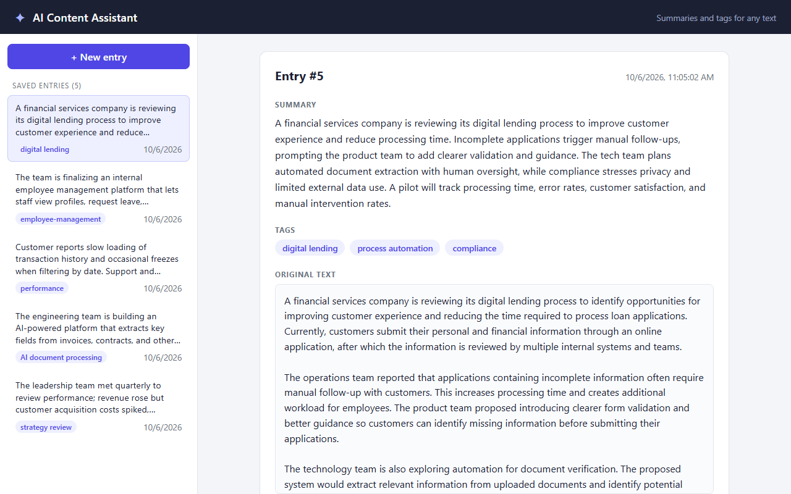

# AI Content Assistant

Submit a block of text (a note, article draft or meeting transcript) and get an LLM-generated summary and exactly three tags.
Entries are stored in SQLite and can be browsed and reopened later.

**Stack:** React (Vite) · FastAPI · SQLAlchemy + SQLite · Groq (`openai/gpt-oss-20b`) via the OpenAI-compatible SDK



## Features
- Submit text, with a loading state, a character counter and clear error messages.
- Server-side validation: blank input is rejected and the length is capped at 20,000 characters.
- AI output is parsed and validated: a non-empty summary and exactly three tags.
- Entries persist in SQLite across restarts; the sidebar lists them and the URL (`#/entries/{id}`) opens one.

## Project structure
```
backend/
  app/
    api/entries.py          # REST endpoints
    core/config.py          # settings from .env
    core/exceptions.py      # custom exceptions + handlers
    database/database.py    # engine, session, init_db
    models/entry.py         # SQLAlchemy model
    schemas/entry.py        # Pydantic request/response models
    services/ai_service.py  # prompt, LLM call, output parsing
    main.py                 # app, CORS, exception handlers
  tests/                    # pytest (mocked AI, in-memory DB)
frontend/
  src/                      # App, api client, components (form, list, detail)
```

## Setup

**Backend** (Python 3.10+)
```bash
cd backend
python -m venv .venv
.venv\Scripts\activate          # macOS/Linux: source .venv/bin/activate
pip install -r requirements.txt
cp .env.example .env            # then set LLM_API_KEY
uvicorn app.main:app --reload   # http://localhost:8000  (docs at /docs)
```
The SQLite file (`backend/database.sqlite`) and its table are created automatically on startup.

**Frontend** (Node 18+)
```bash
cd frontend
npm install
npm run dev                     # http://localhost:5173
```
Optional: copy `frontend/.env.example` to `.env` if the API is not at `http://localhost:8000`.

**Configuration** (`backend/.env`, names only in `.env.example`)

| Variable | Purpose | Default |
|---|---|---|
| `LLM_API_KEY` | Provider API key (required) | none |
| `LLM_BASE_URL` | OpenAI-compatible endpoint | `https://api.groq.com/openai/v1` |
| `LLM_MODEL` | Model name | `openai/gpt-oss-20b` |
| `LLM_TIMEOUT` | Request timeout in seconds | `20` |

## API

| Method | Path | Description |
|---|---|---|
| POST | `/entries` | Validate, call the LLM, store and return the entry (201) |
| GET | `/entries` | List entries, newest first |
| GET | `/entries/{id}` | Get one entry (404 if missing) |

Example response:
```json
{
  "id": 1,
  "original_text": "...",
  "summary": "A concise summary of the submitted text.",
  "tags": ["tag-1", "tag-2", "tag-3"],
  "created_at": "2026-10-06T04:57:42Z"
}
```
Errors: `422` for invalid input, `404` for an unknown entry and `502` when the AI step fails, each with a readable message.

## Tests
```bash
cd backend
pytest
```
The tests use a mocked LLM and an in-memory database, so they never call the provider or touch `database.sqlite`.
They cover input validation, create/list/get, the 404 case, parsing of valid and malformed model output, and the 502 path
(including that nothing is stored when the AI fails).

## Questions

1. **Architecture:** The React form POSTs the text to `POST /entries`. FastAPI validates it with Pydantic (non-blank, max 20,000 chars),
   then `ai_service` calls the LLM with a JSON-only prompt. The response is parsed and checked for a summary plus exactly three tags.
   The original text, summary and tags (stored as JSON) are saved to SQLite through SQLAlchemy, and the new entry is returned.
   The frontend lists entries via `GET /entries` and opens one via `GET /entries/{id}`.
2. **AI choice:** `openai/gpt-oss-20b` hosted on Groq, called through the OpenAI-compatible SDK. It is small, fast and cheap,
   which suits short summarisation, and it supports JSON mode. Provider, base URL and model are env-configurable,
   so switching to OpenAI or another compatible provider needs no code change.
3. **Reliability:** Calls time out after 20s (configurable). JSON mode is requested, and the output is validated strictly.
   A timeout, provider error, invalid JSON, a missing summary or a tag count other than three raises `AIServiceError`, which the API
   returns as HTTP 502 with a readable message. Nothing is saved on failure, and the UI shows the error so the user can retry.
4. **Privacy:** The full submitted text is sent to the provider, along with the system prompt. Nothing else (no user identifiers) is sent.
   In financial services I would avoid sending PII, account or card numbers, KYC data and confidential client information:
   redact or mask before the call, use an enterprise endpoint with zero data retention (or a private/self-hosted model), and keep an audit trail.
5. **Production next steps:**
   - PII redaction and a data-classification gate before any text leaves the system, plus authentication and rate limiting.
   - Retries with backoff, async/queued generation with status polling, and structured logging and metrics for the LLM calls.
   - Postgres with Alembic migrations, pagination on `GET /entries`, and frontend tests plus CI.
6. **AI coding tools:** Claude Code (Claude) helped with the review, refactoring, tests and frontend scaffolding.
   I read each generated change and ran the pytest suite, which uses mocked AI and an in-memory database. I also exercised the
   API and UI manually against the real LLM, and removed unused code and dependencies.

